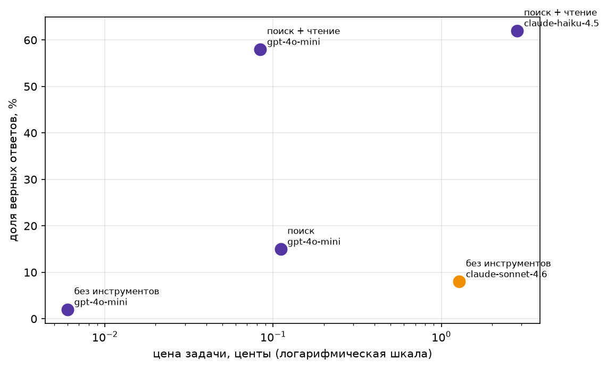

# ДЗ 1. Свежие вопросы и агент

## Датасет

- `data/fresh.jsonl`, 145 вопросов.
- 125 стартовых + 20 своих.
- Свои: ЧМ-2026 по футболу, по-русски.
- Источник: ru.wikipedia, статья о турнире.
- Ответы: фамилии, числа, награды.

## Свежесть

`python check_fresh.py data/fresh.jsonl --sonnet`

- Весь набор: Sonnet 2/145, 1%.
- Свои 20: Sonnet 0/20.
- Угадал `fresh-20`: формат известен заранее.
- Угадал `fresh-43`: мэр выбран в 2025.
- Полный вывод: `data/fresh_check.txt`.

## Агент

- Ядро с семинара: цикл, детектор, леджер.
- `web_search`: en/ru
- `page_find`: строки статьи по словам.
- Калькулятор, `python_exec` без изменений.
- Тесты: `python -m pytest -v`.

Правки по трейсам:
- Промпт: дата, «события уже были».
- Промпт: читай обзоры через `page_find`.
- Промпт: ответ в именительном падеже.
- `is_correct`: даты, числа словами, ё.

## Результат
60 вопросов: 20 своих + 40 стартовых.

| Конфигурация | Модель | Верно | Цена задачи, ¢ | Цена верного, ¢ | Шагов | Секунд |
|---|---|---|---|---|---|---|
| без инструментов | gpt-4o-mini | 2% | 0.006 | 0.363 | 1.0 | 2.6 |
| поиск + чтение | gpt-4o-mini | 58% | 0.084 | 0.144 | 4.8 | 15.7 |
| поиск | gpt-4o-mini | 15% | 0.111 | 0.741 | 6.8 | 26.0 |
| без инструментов | claude-sonnet-4.6 | 8% | 1.278 | 15.332 | 1.0 | 13.4 |
| поиск + чтение | claude-haiku-4.5 | 62% | 2.831 | 4.591 | 4.9 | 17.5 |

Сырые данные: `results_raw.csv`. Трейсы: `traces/`.



## Провалы

1. [`wc-7`](traces/поиск%20+%20чтение/gpt-4o-mini/wc-7.json), mini. Поиск не нашёл. 7 запросов, нужной статьи нет. `page_find` не звала. Ответ «неизвестно». Верно: Гордон.

## Вывод

Тезис подтвердился.

- mini + поиск + чтение: 58%.
- Sonnet без инструментов: 8%.
- Дешевле в 15 раз за задачу.
- Дешевле в 100 раз за верный.
- Без `page_find` хуже и дороже: 15%, 7 шагов.
- Haiku: +4 п.п., в 34 раза дороже.
- Мои 20 по-русски: mini 10/20, Sonnet 1/20.

## Запуск

```
cd hw_1
./setup.sh                                  # окружение, .env, ядро, тесты
# вписать ключ в .env
.venv/bin/jupyter notebook ReAct_agent.ipynb   # Restart & Run All
```

Окружение: `uv sync` по `pyproject.toml`, без uv — `requirements.txt`.
Тесты отдельно: `.venv/bin/python -m pytest -v`.
