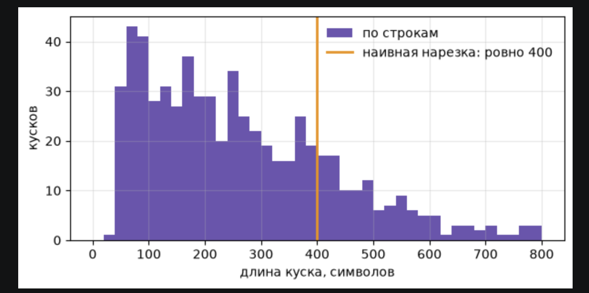
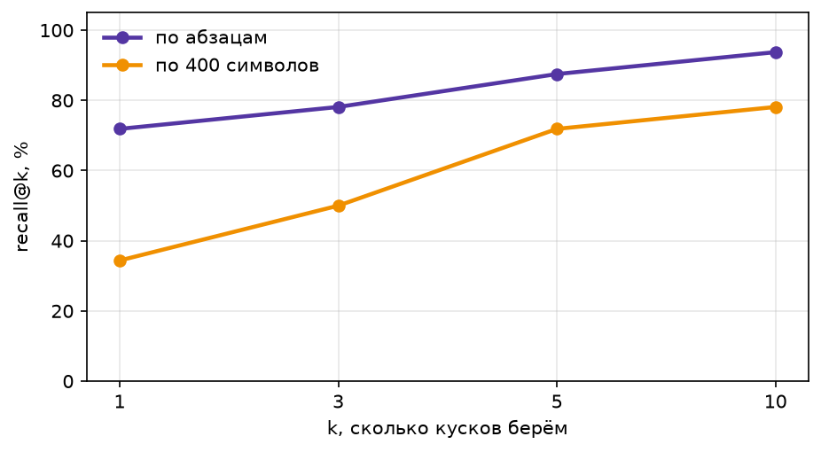
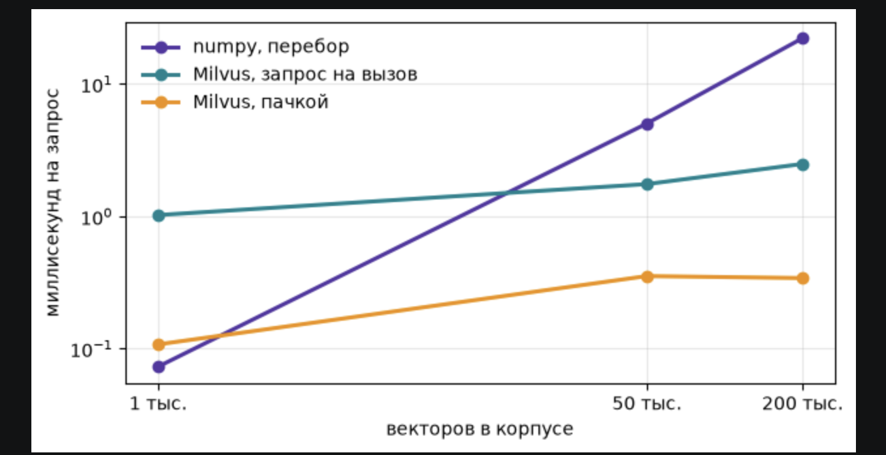
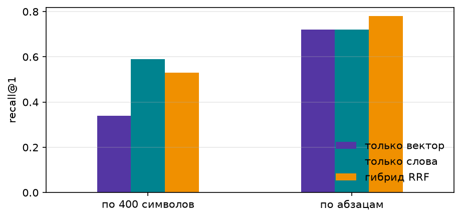
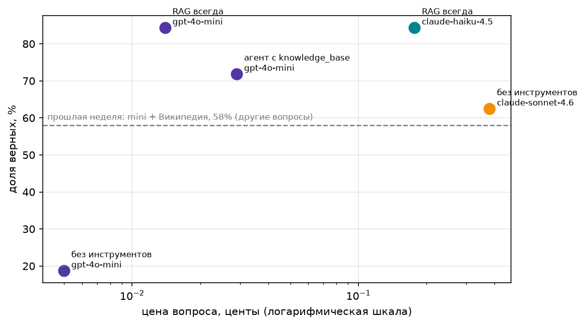
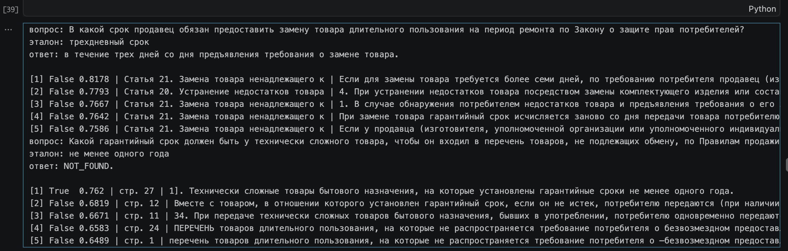
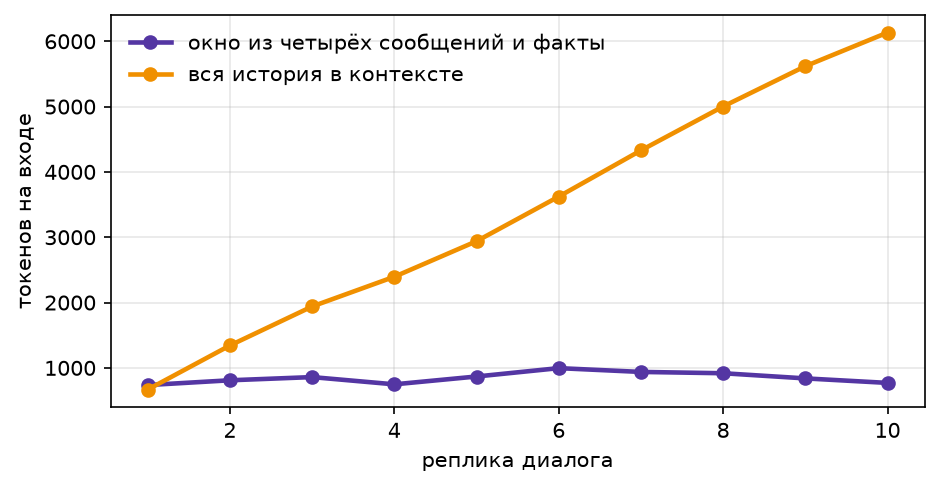

# ДЗ 2. База знаний и память агента

## Корпус

- Тема: права покупателя интернет-магазина.
- Проект: агент поддержки по email.
- Правила продажи товаров, ПП РФ № 657.
  - Действуют с 01.09.2026, свежие для моделей.
  - Официальный PDF, publication.pravo.gov.ru.
  - Скан без текста → OCR tesseract (rus).
  - 27 страниц, номер страницы в метаданных.
- Закон «О защите прав потребителей».
  - consultant.ru, актуальная редакция.
  - 56 статей, глава и статья в метаданных.
- Справка Ozon не подошла: антибот.
- Сборка: `python fetch_corpus.py` → `data/corpus.jsonl`.


## Нарезка

| Нарезка | Кусков |
|---|---|
| по абзацам | 643 |
| по 400 символов | 514 |



## Поиск

- Эмбеддинги `text-embedding-3-small`, 512.
- Кэш на диске: `emb_cache.npz`.
- В тексте для эмбеддинга: документ, раздел.



| k | по абзацам | по 400 символов |
|---|---|---|
| 1 | 72% | 34% |
| 3 | 78% | 50% |
| 5 | 88% | 72% |
| 10 | 94% | 78% |

- k = 5: 88%, дальше +6 п.п. за 2× контекста.

## Milvus

- `docker compose up -d`, Milvus 2.6.
- Коллекция `lines`, 643 куска, COSINE.
- Метаданные: документ, раздел, страница, ссылка.
- Совпадение с numpy: 100%.
- Фильтр: `doc == "Правила продажи товаров (ПП РФ № 657)"`.



| векторов | numpy, мс | Milvus, мс | Milvus пачкой, мс |
|---|---|---|---|
| 643 | 0.07 | 1.02 | 0.11 |
| 50 000 | 5.03 | 1.75 | 0.35 |
| 200 000 | 22.20 | 2.49 | 0.34 |

## Гибрид

- Слова по основам: падежи ломают точное совпадение.
- Слияние рангов RRF.

| Нарезка | Поиск | recall@1 | recall@5 |
|---|---|---|---|
| по 400 символов | вектор | 34% | 72% |
| по 400 символов | слова | 59% | 78% |
| по 400 символов | гибрид | 53% | 81% |
| по абзацам | вектор | 72% | 88% |
| по абзацам | слова | 72% | 88% |
| по абзацам | гибрид | **78%** | **91%** |



- Законы: точные термины, слова не хуже вектора.
- Гибрид: +6 п.п. @1, +3 п.п. @5.
- Нарезка важнее гибрида.

## Ответы

32 вопроса с ответом. Цена в центах.

| Конфигурация | Модель | Верно | Цена вопроса | Цена верного |
|---|---|---|---|---|
| без инструментов | claude-sonnet-4.6 | 62% | 0.380 | 0.609 |
| без инструментов | gpt-4o-mini | 19% | 0.005 | 0.026 |
| RAG всегда | gpt-4o-mini | 84% | 0.014 | 0.017 |
| RAG всегда | claude-haiku-4.5 | 84% | 0.177 | 0.210 |
| агент с `knowledge_base` | gpt-4o-mini | 72% | 0.029 | 0.040 |

- Перебор k для mini + RAG: k=1 69%, k=3 75%, k=5 84%, k=10 88%.



Отказы:

| Конфигурация | Модель | Честно отказал (из 10) | Отказал зря (из 32) |
|---|---|---|---|
| без инструментов | claude-sonnet-4.6 | 5 | 2 |
| без инструментов | gpt-4o-mini | 9 | 6 |
| RAG всегда | gpt-4o-mini | 10 | 4 |
| RAG всегда | claude-haiku-4.5 | 10 | 3 |
| агент с `knowledge_base` | gpt-4o-mini | 8 | 0 |

- Sonnet без поиска выдумывает: 5 из 10.
- RAG отказывает честно: 10 из 10.
- Зря отказы RAG = промахи поиска.

- `is_correct`: основы слов, числа словами → цифры.

## Агент

- `knowledge_base(query, doc="")`: 5 кусков из `lines`.
- `doc` — фильтр: закон или правила.
- Чужой документ → подсказка со списком.
- Тесты без модели: 5 кусков / фильтр / ошибка — ок.
- 2.9 вызова модели на вопрос.
- Хуже RAG: 72% против 84%, дороже в 2 раза.
- Ищет 1–2 раза своим запросом → нужный кусок реже.
- Зря не отказывает (0), но выдумал 2 из 10.
- Отвечает фразой, а не словами нормы.
- Вывод: на узком корпусе искать всегда проще.

## Провалы

1. `q-7`, mini, RAG. Поиск не нашёл.
   - Вопрос: замена на период ремонта, ст. 20.
   - В контексте: ст. 21, замена товара.
   - Та же норма про три дня.
   - Ответ «в течение трех дней» — верно по смыслу.
   - Проверка: «трехдневный» ≠ «трех дней».
   - Менять: гибрид («ремонт»), проверку чисел.
2. `q-31`, mini, RAG. Нашёл, ответ неверный.
   - Верный кусок на 1-м месте.
   - Это пункт 11 перечня без заголовка.
   - Заголовок «не подлежащих обмену» — в другом куске.
   - Модель не связала, ответ NOT_FOUND.
   - Менять: нарезку, клеить заголовок раздела.



## Память

- Журнал: `episodes.jsonl`, в контекст не идёт.
- Факты: коллекция Milvus `facts`, 3 ближайших.
- Модель отдаёт полный список → старый заменяется.
- Поиск: по вопросу + по вопросу с фактами, RRF.
- Окно: последние 4 реплики.
- Тесты без модели: пусто / нашёлся / заменён — ок.




| Режим, 10 вопросов | Токенов на входе | Цена, $ |
|---|---|---|
| окно + факты | 8 483 | 0.0016 |
| вся история | 33 988 | 0.0035 |

- В 4 раза меньше токенов.
- Вся история растёт с каждой репликой.

## Вывод

Тезис подтвердился: верный ответ подешевел.

| | Верно | Цена верного, ¢ |
|---|---|---|
| ДЗ1: mini + Википедия | 58% | 0.144 |
| ДЗ2: mini + RAG | 84% | 0.017 |
| ДЗ2: Sonnet без инструментов | 62% | 0.609 |

- В 8 раз дешевле прошлой недели.
- Вопросы другие — сравнение грубое.
- За счёт: один вызов вместо 5 шагов.
- Дешёвая модель + RAG > Sonnet: +22 п.п., в 36 раз дешевле.
- Дороже всего — Sonnet без поиска.


## Запуск

```
cd hw_2
./setup.sh                              # окружение, .env, Milvus, корпус
# вписать ключ в .env
.venv/bin/jupyter notebook hw2.ipynb    # Restart & Run All
```
