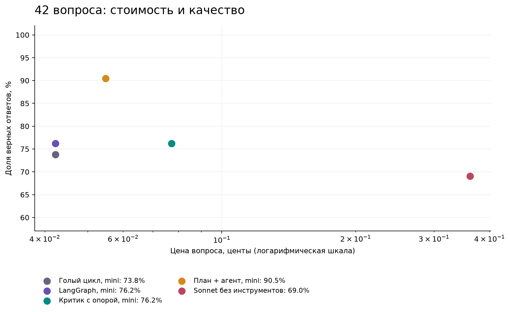

# ДЗ 3. Фреймворк, критик и план

- Агент и 42 вопроса из ДЗ 2.
- Один фреймворк: LangGraph.
- Два паттерна: критик с источниками и план.
- Код целиком в `hw_3.ipynb`, по порядку семинара.
- Подробный отчёт: [report.md](report.md).

## Результат

| Конфигурация | Верно | Вызовов/вопрос | Токенов/вопрос | ¢/вопрос | ¢/верный |
| --- | --- | --- | --- | --- | --- |
| голый цикл, mini | 31/42, 73,8% | 4,76 | 2794 | 0,0422 | 0,0572 |
| LangGraph, mini | 32/42, 76,2% | 4,81 | 2828 | 0,0422 | 0,0554 |
| критик, mini | 32/42, 76,2% | 6,95 | 4815 | 0,0771 | 0,1013 |
| план, mini | 38/42, 90,5% | 6,48 | 3502 | 0,0548 | 0,0606 |
| Sonnet без инструментов | 29/42, 69,0% | 1,00 | 325 | 0,3617 | 0,5238 |



- Вызовы и токены включают чат и эмбеддинги.
- Цена верного = стоимость всей конфигурации / число верных.
- Логи: `results/calls.jsonl`, ответы: `results/answers/`.
- У критика учтена стоимость исходного ответа из LangGraph; API за него повторно не списывал.

## Налог фреймворка

- Пустой вопрос «Сколько будет 2 + 2?».
- Первый запрос: цикл 265 токенов, LangGraph 265. Налог — **0**.
- Тела запросов совпадают байт в байт, описания аргументов сохранены.
- Сравнение: `results/first_request.diff`.
- StateGraph дал состояние и переходы без добавочных токенов.

## Критик и план

- Критик: исправил 0, испортил 0. 13 попыток исправления.
- План: 32/42 → 38/42, цена верного 0,0554 → 0,0606 ¢.
- Лимит в коде до HTTP-запроса. Пример с одним вызовом: `results/budget_demo.json`.
- После обрыва: `NOT_FOUND (достигнут лимит вызовов модели)`.

## Проверка проверки

- Просмотрены 10 неверных у цикла, LangGraph, критика и Sonnet; все 5 у плана.
- На самом деле верны: у плана 1, у Sonnet 5, у остальных 0.
- Дополнительно снято одно ложное принятие Sonnet: перепутан субъект доказывания.
- Исправлены числа, окончания и равнозначные формулировки.
- Разбор: [report.md](report.md#проверка-проверки), `results/checker_audit.md`.

## Вывод

1. План: +14,3 п.п., цена верного на 9% выше, но в 8,6 раза ниже Sonnet.
2. Критик: качество не изменилось, цена верного в 1,83 раза выше.

## Запуск

```bash
cd hw_3
./setup.sh
.venv/bin/jupyter lab hw_3.ipynb
```

Python 3.11+. Ноутбук выполнен. Restart & Run All с `RUN_LIVE = False` показывает сохранённые результаты без платных запросов.

Для нового прогона: вписать ключ в `.env`, поставить `RUN_LIVE = True` в первой ячейке и выполнить все ячейки. Новые результаты сохраняются отдельно в `runs/`. Для них нужно заново просмотреть ошибки и обновить отчёт.

`.env` и окружение исключены из Git. Исходные материалы сохранены локально в `_archive_before_hw3/`, в сдачу не входят.
