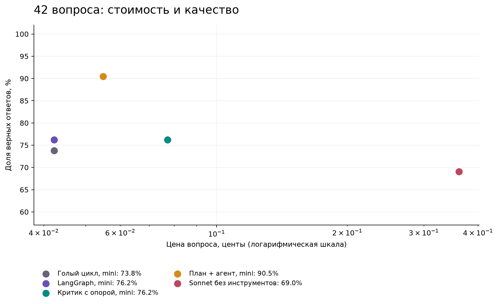

# ДЗ 3. Фреймворк, критик и план

## Агент и данные

- Агент из ДЗ 2: вопросы о правах покупателя интернет-магазина.
- `knowledge_base(query, doc="")`: пять ближайших абзацев, фильтр по документу.
- Те же 42 вопроса: 32 с ответом, 10 без ответа в корпусе.
- Те же 643 абзаца, эмбеддинги `text-embedding-3-small`, 512.
- Поиск на NumPy по сохранённым векторам. В ДЗ 2 top-5 совпал с Milvus.
- Модель агента: `openai/gpt-4o-mini`.
- Один фреймворк: LangGraph. Два паттерна: критик и план.

Вопросы оцениваются по сохранённому корпусу. Ответ на вопрос вне корпуса должен быть `NOT_FOUND`, даже если модель знает его из других источников.

## Счётчик

- Один `httpx.Client` для всех конфигураций и эмбеддингов.
- `event_hooks={"response": [on_response]}`.
- На каждом ответе: конфигурация, вопрос, модель, входные и выходные токены, `usage.cost`.
- Метки через `ContextVar`: параллельные вопросы не смешиваются.
- Все HTTP-ответы: `results/calls.jsonl`. 811 ответов, все со статусом 200 и ценой.
- Стоимость берётся из API. Если `usage.cost` отсутствует, прогон останавливается.

У каждой конфигурации одинаковый исходный кэш эмбеддингов из ДЗ 2. Новые запросы оплачиваются в своей конфигурации. Построение прежнего индекса в цену вопроса не входит.

## Результаты

Все конфигурации на одних 42 вопросах. Цена в центах.

| Конфигурация | Верно | Вызовов/вопрос | Токенов/вопрос | Цена вопроса, ¢ | Цена верного, ¢ |
| --- | --- | --- | --- | --- | --- |
| голый цикл, mini | 31/42, 73,8% | 4,76 | 2794 | 0,0422 | 0,0572 |
| LangGraph, mini | 32/42, 76,2% | 4,81 | 2828 | 0,0422 | 0,0554 |
| критик, mini | 32/42, 76,2% | 6,95 | 4815 | 0,0771 | 0,1013 |
| план, mini | 38/42, 90,5% | 6,48 | 3502 | 0,0548 | 0,0606 |
| Sonnet без инструментов | 29/42, 69,0% | 1,00 | 325 | 0,3617 | 0,5238 |



- Вызовы и токены в таблице включают чат и эмбеддинги.
- Цена верного = стоимость всей конфигурации / число верных.
- Чат-вызовов на вопрос отдельно: 2,90 / 2,93 / 4,86 / 4,31 / 1,00.
- Sonnet: `anthropic/claude-sonnet-4.6`, один ответ по памяти, без корпуса.
- Фактически списано за основной эксперимент, пробы и лимит: $0,22524.

Отказы отдельно:

| Конфигурация | Верно из 32 с ответом | Верный отказ из 10 |
| --- | --- | --- |
| голый цикл | 24 | 7 |
| LangGraph | 24 | 8 |
| критик | 24 | 8 |
| план | 28 | 10 |
| Sonnet без инструментов | 24 | 5 |

Трейсы: `results/answers/`. Сводка: `results/summary.csv`.

## LangGraph и налог

- Тот же системный промпт, модель и JSON-схема `knowledge_base`.
- `StateGraph`: узел модели → инструмент → модель; готовый ответ → конец.
- На последнем шаге инструменты отключаются, агент отвечает по найденному.

Пустой вопрос: «Сколько будет 2 + 2? Ответь только числом».

| Исполнение | Первый запрос, входных токенов | Тело HTTP |
| --- | --- | --- |
| голый цикл | 265 | 1778 байт |
| LangGraph | 265 | 1778 байт |

- Налог: **0 токенов**.
- Запросы совпадают байт в байт, включая описания аргументов `query` и `doc`.
- Исходные тела: `results/probe_bare_first.body`, `results/probe_langgraph_first.body`.
- Сравнение: `results/first_request.diff`.
- Это низкоуровневый StateGraph, без обёртки `create_agent`. Нулевой налог относится к этой реализации.
- Разницу в один верный ответ между базовыми прогонами нельзя уверенно приписать графу: API недетерминирован даже при temperature=0.

LangGraph взял на себя хранение состояния и переходы между узлами без дополнительных токенов.

## Критик

Выбрал LangGraph: 32/42 против 31/42 у цикла. При равном качестве сравнивается цена верного ответа.

- Начальный ответ взят из базового прогона LangGraph.
- Критик отдельно ищет по исходному вопросу и видит найденные агентом абзацы.
- Эталон ответа ему не передаётся.
- Вердикт: `supported`, `issue`, `source_id`, `evidence_quote`.
- Код проверяет, что положительный вердикт содержит дословную цитату из указанного источника.
- Не больше двух исправлений, после каждого — новая проверка.

| Показатель | Число |
| --- | --- |
| отклонил исходный ответ | 7 |
| попыток исправления | 13 |
| неверных исправил | 0 |
| верных испортил | 0 |

Исходный ответ переиспользован, чтобы сравнение было парным. Его полная стоимость включена в строку критика. Повторно API за него не списывал: сумма строк таблицы поэтому на $0,01774 выше фактического списания.

- Качество не изменилось.
- Цена верного выросла в 1,83 раза.
- Критик ошибочно принял `q-9`: источник говорит, что доказывает потребитель, ответ — что продавец.
- В `none-6` применил российскую норму к вопросу про ЕС.
- Настоящая цитата ещё не означает, что ответ из неё следует.

## План

- Один вызов mini пишет 2–3 шага поиска: запросы и нужный документ.
- План добавляется к промпту того же исполнителя.
- Вызов планировщика входит в цену.

| | Без плана | С планом |
| --- | --- | --- |
| верно | 32/42 | 38/42 |
| верный отказ | 8/10 | 10/10 |
| цена верного, ¢ | 0,0554 | 0,0606 |

- +14,3 п.п. к качеству.
- Цена верного выросла на 9%.
- Пример `q-11`: без плана агент описал размещение информации на сайте, с планом нашёл срок «до заключения договора».

## Проверка проверки

Проверяется короткий ответ после `FINAL:`, без обрезания текста.

- Числа словами → цифры, `ё` → `е`, окончания → основы.
- «Трехдневный срок» = «в течение трёх дней», но не «три месяца».
- Пустой эталон не считается совпадением с любым ответом: нужен `NOT_FOUND`.
- Все конфигурации проверяются одной функцией.

Просмотрено до десяти неверных в каждой конфигурации. У плана неверных было пять — просмотрены все.

| Конфигурация | Просмотрено | На самом деле верны |
| --- | --- | --- |
| голый цикл | 10 | 0 |
| LangGraph | 10 | 0 |
| критик | 10 | 0 |
| план | 5 | 1 |
| Sonnet | 10 | 5 |

Правки:

- `q-20`: «возврат уплаченных денег» = «возврат уплаченной денежной суммы».
- `q-18`: принят вариант «все комплектующие, входящие в комплект товара».
- `q-22`: принято «получение подтверждения намерения покупателя».
- `q-1`: эталонная цитата допускает цену отдельной работы или общую цену заказа. Добавлен второй допустимый вариант, сама цитата не менялась.
- Дополнительно снято ложное принятие Sonnet в `q-9`: «потребителю» было дополнением, а доказывал в ответе продавец. Добавлена проверка субъекта.

После правок: план 37 → 38 верных, Sonnet 25 → 29. У Sonnet исправлены пять ложных отрицаний и одно ложное принятие.

Подробности: `results/checker_audit.md`, `results/manual_audit.json`.
Допустимые варианты: `data/answer_aliases.json`.

## Лимит

- Проверка до `HTTP.post`, включая повторные попытки.
- Агент: до 6 шагов; план: ещё один вызов.
- Внешний лимит: 8 попыток на вопрос; вся цепочка критика — 24 с учётом начального ответа.
- Не более 450 выходных токенов на ответ.
- Общий стоп по журналу: $2.

Проверочный вопрос:

> Сравни сроки отказа от товара при дистанционной покупке и устранения недостатков. Найди обе нормы через knowledge_base.

При лимите в один чат-вызов первый вызов выбрал инструмент. После поиска попытка второго вызова заблокирована кодом.

```text
NOT_FOUND (достигнут лимит вызовов модели)
```

Чат-вызовов: 1. Сработал лимит: да. Трасса: `results/budget_demo.json`.

## Вывод

1. План дал +14,3 п.п. к качеству: 32/42 → 38/42. Цена верного на 9% выше базового агента, но в 8,6 раза ниже Sonnet без инструментов на этом наборе.
2. Критик оказался дорогим украшением: 0 исправлений и 0 ухудшений, цена верного выросла в 1,83 раза.
